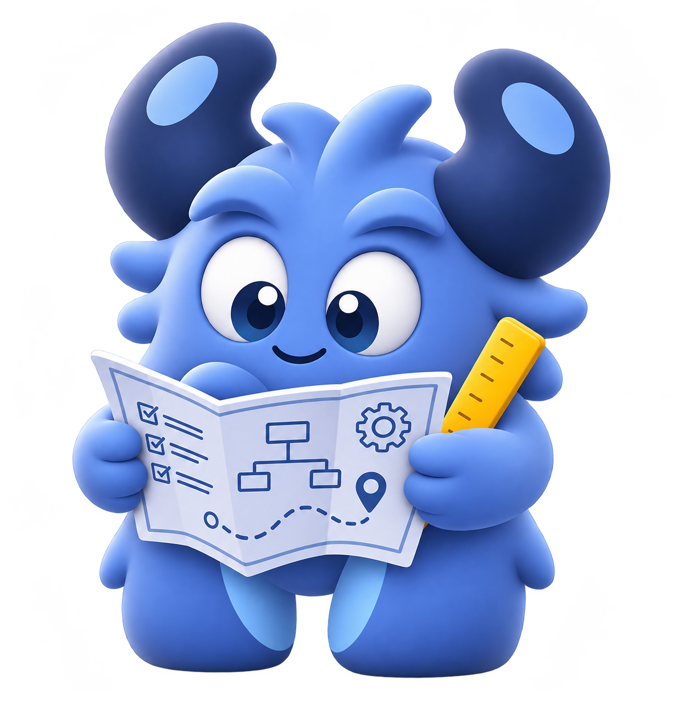

<div class="moxter-userguide-title" markdown="1">
#  Sticky callers
</div>

## Make variables sticky across several calls


```java
      MoxCaller userA_on_cke_1 = mx.caller().withAuth(getAuthenticationFor(userA))
                                            .withVars(cke_1_vars);
      MoxCaller userB_on_cke_1 = mx.caller().withAuth(getAuthenticationFor(userB))
                                            .withVars(cke_1_vars);
      MoxCaller userB_on_cke_2 = mx.caller().withAuth(getAuthenticationFor(userB))
                                            .withVars(cke_2_vars);
```


> **Reminder**: Careful! Moxter callers are immutable
